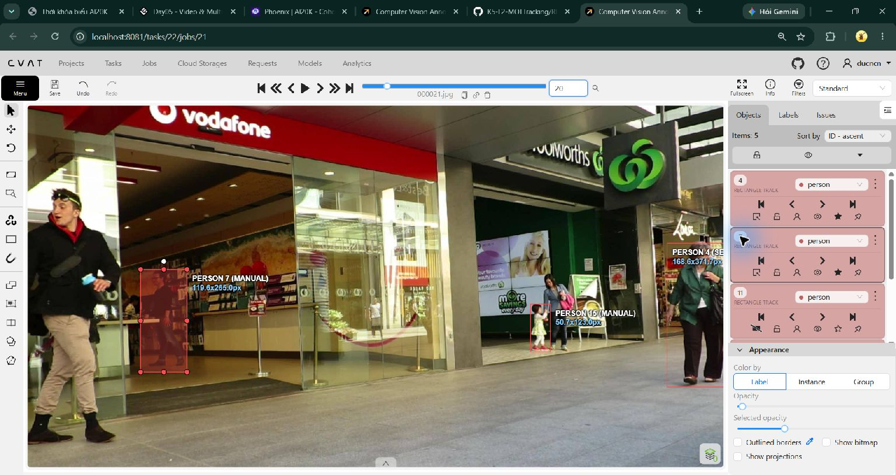
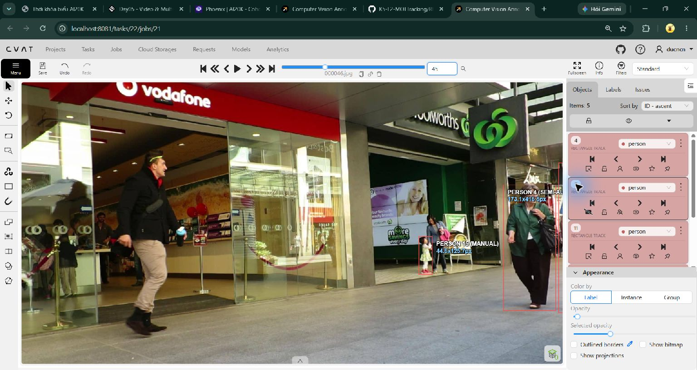
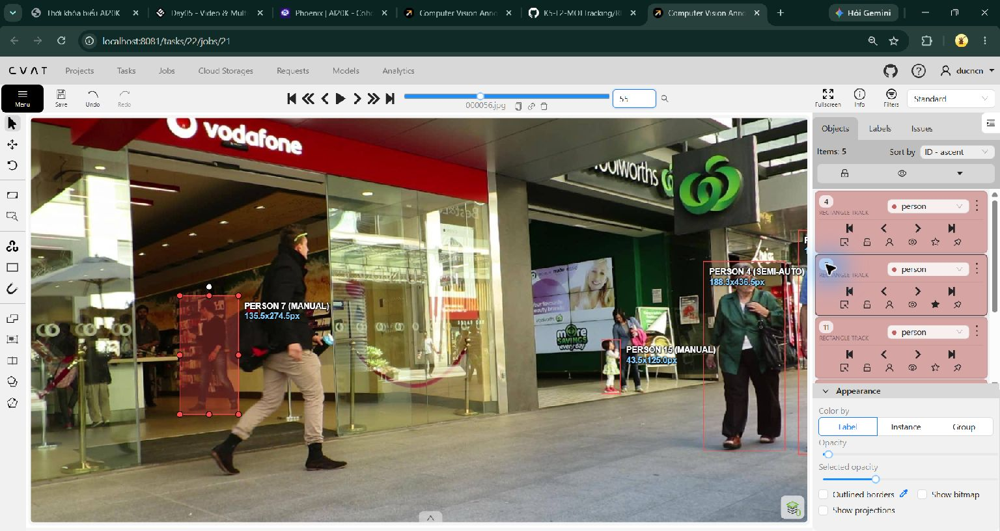

# Báo cáo cá nhân — Nguyễn Cao Ngọc Đức — 2A202603178

Đoạn video: MOT17-09, 150 frame (frame 1–150), nguồn MOTChallenge, giấy phép CC BY-NC-SA 3.0.

## 0. Thông tin học viên

- Họ tên: Nguyễn Cao Ngọc Đức
- MSSV: 2A202603178
- Mã đề (A/B/C): A
- Task: `DAY05-MOT17-09-A-2A202603178`
- Job CVAT local: http://localhost:8081/tasks/22/jobs/21
- Dữ liệu đã chuẩn bị: 150 frame 1920×1080, CVAT frame 0–149; label `person`, Rectangle, dùng chế độ Track khi gán.
- Email: không cung cấp
- Link repository: https://github.com/ducnguyen-ai/K5-L2-Day05-NguyenCaoNgocDuc-2A202603178-MOTTracking
- Tổng thời gian làm bài: khoảng **120 phút**, tự ước lượng.
- Giờ bắt đầu / kết thúc: không ghi lại chính xác.

## 1. Xem trước đoạn video (CP0)

Không có bản ghi đầy đủ trước khi vẽ. Các mốc dưới đây được đối chiếu từ **bản xuất cuối cùng**, không trình bày như nhật ký đã ghi trước khi gán. Frame dùng hệ CVAT 0–149; mốc có mặt phụ thuộc cờ đã lưu, không phải kết quả đối chiếu ground truth.

| Mã | Frame xuất hiện | Frame cuối thấy được | Rẽ / dừng / đổi tốc độ | Bị che theo bản lưu | Ghi chú |
|---|---:|---:|---|---|---|
| P1 | 0 | 149 | Chưa có ghi chép mốc riêng | 26–39, 50–54 (một phần); 40–49 (outside) | Người xử lý đoạn che; đã Merge hai track trước/sau khi khuất. |
| P2 | 60 | 149 | Chưa có ghi chép mốc riêng | 60–99 (một phần); Không có (outside) | Người ở gần cửa kính/quầy; cần rà box toàn thân khi bị che một phần. |
| P3 | 0 | 149 | Chưa có ghi chép mốc riêng | Không có (một phần); Không có (outside) | Người mặc áo khoác xanh; kích thước box tăng khi lại gần camera. |
| P4 | 40 | 149 | Chưa có ghi chép mốc riêng | Không có (một phần); Không có (outside) | Người đội mũ, áo xanh lam; xuất hiện từ mép phải. |
| P5 | 0 | 146 | Chưa có ghi chép mốc riêng | 106–109, 137–139, 143–146 (một phần); 110–136, 147–149 (outside) | Trẻ nhỏ cạnh người lớn; có đoạn mất hẳn rồi hiện lại. |

Đối chiếu người trong đề với ID thực tế của hai định dạng xuất:

| Mã người | Track ID trong MOT | Track ID trong XML CVAT |
|---|---:|---:|
| P1 | 2 | 1 |
| P2 | 5 | 3 |
| P3 | 1 | 0 |
| P4 | 4 | 2 |
| P5 | 3 | 4 |

ID của hai định dạng không nhất thiết giống nhau. Việc đối chiếu dựa trên ảnh tham chiếu P1–P5 và box tại cùng frame, không đổi ID bằng cách chỉnh file xuất.

## 2. Keyframe và thời gian (CP1, CP4)

Số keyframe dưới đây theo cách tính của script lớp: keyframe ở các frame có mặt; những mốc `outside` không cộng vào số keyframe có mặt.

| Mã | Số keyframe | Keyframe ở frame | Số frame có mặt | Keyframe / 100 frame | Thời gian (phút) | Chỗ khó |
|---|---:|---|---:|---:|---|---|
| P1 | 17 | 0, 10, 18, 20, 26, 30, 50, 55, 60, 70, 80, 90, 100, 110, 120, 130, 140 | 140 | 12.1 | Không ghi riêng | Người xử lý đoạn che; đã Merge hai track trước/sau khi khuất. |
| P2 | 10 | 60, 70, 80, 90, 100, 110, 120, 130, 140, 149 | 90 | 11.1 | Không ghi riêng | Người ở gần cửa kính/quầy; cần rà box toàn thân khi bị che một phần. |
| P3 | 18 | 0, 10, 20, 26, 30, 40, 50, 60, 70, 80, 90, 100, 110, 120, 130, 134, 140, 149 | 150 | 12.0 | Không ghi riêng | Người mặc áo khoác xanh; kích thước box tăng khi lại gần camera. |
| P4 | 12 | 40, 50, 60, 70, 80, 90, 100, 110, 120, 130, 140, 149 | 110 | 10.9 | Không ghi riêng | Người đội mũ, áo xanh lam; xuất hiện từ mép phải. |
| P5 | 15 | 0, 10, 20, 30, 40, 50, 60, 70, 80, 90, 100, 106, 137, 140, 143 | 120 | 12.5 | Không ghi riêng | Trẻ nhỏ cạnh người lớn; có đoạn mất hẳn rồi hiện lại. |
| **Tổng** | **72** | — | **610** | **11.8** | Khoảng 120 phút | — |

Keyframe / 100 frame của cả bài = 72 ÷ 610 × 100 = **11.8**. Không có số đo thời gian riêng từng người. P3 có nhiều keyframe có mặt nhất (18); P1 có thêm mốc Outside để xử lý đoạn khuất.

## 3. Đoạn bị che (CP2)

Người bị che: **P1**. Các mốc lấy trực tiếp từ cờ trong bản xuất cuối:

| Mốc | Frame |
|---|---:|
| Bắt đầu bị che một phần (`occluded`) | 26 |
| Mất hẳn (`outside`) | 40 |
| Hiện lại, tắt `outside` | 50 |
| Thấy rõ trở lại, tắt `occluded` | 55 |

- Đoạn khuất hẳn: frame 40–49, **10 frame = 0.33 giây** ở 30 fps.
- Quyết định: **giữ cùng ID**, đã dùng Merge để nối hai track bị tạo riêng trước/sau đoạn khuất.
- Cơ sở quyết định: đoạn khuất dưới ngưỡng 60 frame; hình dáng, trang phục và vị trí/hướng di chuyển cho phép tiếp tục đối chiếu cùng người. Khi mất hẳn dùng `outside`; khi còn nhìn thấy một phần dùng `occluded` và giữ box toàn thân ước lượng.
- Trong MOT, P1 dùng ID 2 trước và sau khoảng khuất; trong XML là ID 1.

Ảnh minh chứng chụp trực tiếp từ job **sau khi Merge**: frame 20 trước khi bắt đầu che, frame 45 trong đoạn Outside, frame 55 sau khi hiện lại. Trước/sau hiển thị cùng ID giao diện PERSON 7; ID này khác số đánh lại trong các file xuất.







Nguồn ảnh minh chứng: MOT17, MOTChallenge (Milan et al., 2016), CC BY-NC-SA 3.0.

## 4. Tự review ID (CP3)

Đã xác nhận rà lại và hoàn thành bài. Lỗi thực tế được ghi nhận là **fragmentation ở P1**: sau khi bật Outside và không tìm lại track cũ, đã vẽ track mới khi người xuất hiện lại. Hai track này đã được Merge. Không ghi nhận lỗi nào khác qua lần kiểm tra cuối; không có nhật ký tách riêng thứ tự hai lượt review theo yêu cầu, nên không tự gán số lượt phát hiện.

| Frame | Mã người | Loại lỗi | Mô tả | Phát hiện ở lượt | Đã sửa? |
|---|---|---|---|---|---|
| Quanh đoạn khuất của P1; bản cuối Outside 40–49 | P1 | `fragmentation` | Ban đầu tạo hai ID cho cùng người trước và sau đoạn khuất; đã Merge thành một track. | Trong lúc làm và kiểm tra lại; không ghi số lượt | Có |
| 0–149 | P1 | — | Đối chiếu bản xuất sau Merge: cùng một ID MOT #2, chỉ vắng 40–49 rồi hiện lại từ 50. Đây là dòng kiểm tra sau sửa, không phải một lỗi mới. | Đối chiếu file xuất | Không cần sửa thêm theo phản hồi cuối |
| Toàn đoạn | P1–P5 | — | Sau rà soát không ghi nhận thêm lỗi; script báo đúng 5 track, 0 lỗi và 0 cảnh báo. Dòng này không được cộng thành một lỗi mới. | Rà bản cuối và chạy script | Không ghi nhận lỗi thêm |

Tổng hợp lỗi **đã xác nhận**:

| `id_switch` | `fragmentation` | `lost` | `merge` | `false_track` | `drift` | `flag` |
|---:|---:|---:|---:|---:|---:|---:|
| 0 | 1 | 0 | 0 | 0 | 0 | 0 |

Không ghi nhận trường hợp lỗi chỉ được tìm thấy ở lượt 2. Không có đủ ghi chép để so sánh riêng hiệu quả hai lượt; không suy diễn từ kết quả script thành việc đã hoàn tất chính xác từng bước review bằng mắt.

## 5. File xuất và kết quả tự kiểm (CP4)

| Kiểm tra | Kết quả |
|---|---|
| Tên file MOT 1.1 | `src/exports/NguyenCaoNgocDuc_mot.zip` |
| Tên file CVAT for video 1.1 | `src/exports/NguyenCaoNgocDuc_cvat_video.zip` |
| Số track ID trong `gt/gt.txt` | 5 |
| Frame outside không có dòng trong MOT | Đúng; P1 không có dòng ở frame CVAT 40–49 |
| Job đã completed trên CVAT local | Có, Job #21 |
| Ảnh gốc trong ZIP | Không có |

Đã chạy lệnh của repo:

```bash
python src/check_submission.py --mot src/exports/NguyenCaoNgocDuc_mot.zip --cvat src/exports/NguyenCaoNgocDuc_cvat_video.zip
```

Kết quả kiểm tra:

```text
Số track ID: 5 | Tổng số box: 610
Tổng: 72 keyframe / 610 frame có mặt = 11.8 keyframe / 100 frame
Lỗi: 0 | Cảnh báo: 0
Đạt.
```

Script kiểm cấu trúc và các dấu hiệu bất thường, không có ground truth và không tính MOTA/IDF1. Không có cảnh báo không tự chứng minh tất cả box/ID đều đúng về ngữ nghĩa. Hai file được xuất trực tiếp từ CVAT, không chỉnh JSON/XML/MOT bằng tay.

## 6. Ba câu kết

1. **Nếu gán lại, nên đặt keyframe khác ở đâu và vì sao?**

   Cách làm ban đầu tập trung vào frame đầu, mốc người biến mất/bị che và mốc hiện lại. Chưa chọn keyframe có hệ thống theo chỗ đổi hướng hoặc đổi tốc độ. Điểm cần cải thiện là tua các frame giữa hai mốc, xem box có lệch người không; thêm keyframe ngay chỗ rẽ, bắt đầu dừng/đi tiếp hoặc thay đổi kích thước rõ. Nếu đoạn chuyển động đều và box vẫn khớp thì không cần thêm mốc chỉ vì đến một số frame cố định.

   Quy tắc cần nhớ: **box được chỉnh ở frame nào thì frame đó trở thành keyframe**. CVAT nội suy giữa các mốc; thêm keyframe là sửa chỗ nội suy chưa khớp. Mốc che khuất cần thay cờ Outside/Occluded đúng lúc, đồng thời vẫn giữ đúng ID.

2. **Chỗ chưa chắc cùng ID hay ID mới và cách xử lý:**

   P1 là trường hợp thực tế: sau khi bật O, box biến mất nên đã vẽ một track mới khi người đó hiện lại. Sau khi được giải thích Outside chỉ ẩn box trong đoạn vắng, đã Merge hai track. Trong bản cuối, P1 khuất hẳn 10 frame (40–49), khoảng 0,33 giây, dưới ngưỡng 60 frame; do đó tiếp tục cùng ID khi xác định đúng người. Bật Show all interpolation tracks để tìm lại track ở panel Objects và tắt Outside khi hiện lại.

3. **Lỗi ID có thể ảnh hưởng dự đoán chuyển động và metric thế nào?**

   Lỗi fragmentation đã gặp làm lịch sử chuyển động của cùng người bị tách làm hai. Hệ thống dự đoán có thể mất thông tin hướng đi/vận tốc trước đoạn che và coi người hiện lại là đối tượng mới. IDF1 phản ánh trực tiếp việc duy trì đúng danh tính xuyên suốt; MOTA cũng có thể bị ảnh hưởng bởi đổi ID, bỏ sót hoặc báo thừa. Không có ground truth hay phép đánh giá metric trong bài nộp này để kết luận mức giảm cụ thể hoặc khẳng định metric nào giảm nhiều hơn về số điểm.

## Bonus

Chưa thực hiện hoặc xuất riêng các phần bonus B1/B2/B3; không báo cáo kết quả bonus từ phần gợi ý tracking dùng cho bài chính.

## 7. Tài liệu tham khảo và công cụ AI đã dùng

- Repo lớp: `docs/GUIDELINE.md`, `docs/CVAT_CHEATSHEET.md`, `docs/MOT_FORMAT.md`, `CHECKPOINTS.md`, `src/setup_local_lab.py`, `src/check_submission.py`.
- Dữ liệu: MOT17-09, MOTChallenge (Milan et al., 2016), CC BY-NC-SA 3.0; chỉ dùng trong lớp. Không đưa ảnh gốc hoặc ground truth gốc vào repo nộp.
- CVAT Community local: gán, Merge, chỉnh keyframe và cờ che khuất, xuất MOT 1.1 và CVAT for video 1.1.
- Trợ lý AI hỗ trợ setup, giải thích thao tác/keyframe, đối chiếu file xuất và tổng hợp báo cáo từ bản lưu cùng trải nghiệm đã xác nhận.
- Có dùng YOLO11 pretrained kết hợp ByteTrack chạy GPU local để tạo gợi ý P3–P5; P1 và P2 được giữ từ phần tự gán. Các gợi ý đã được kiểm tra, chỉnh sửa và Save trước khi xuất. Không mô tả toàn bộ quá trình là chỉ gán tay, không dùng model.
